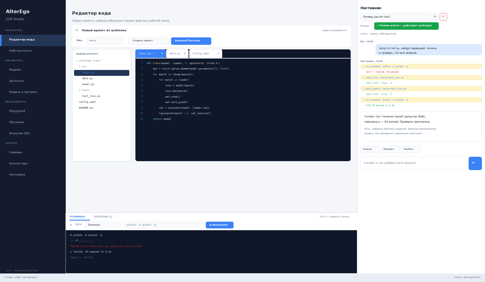
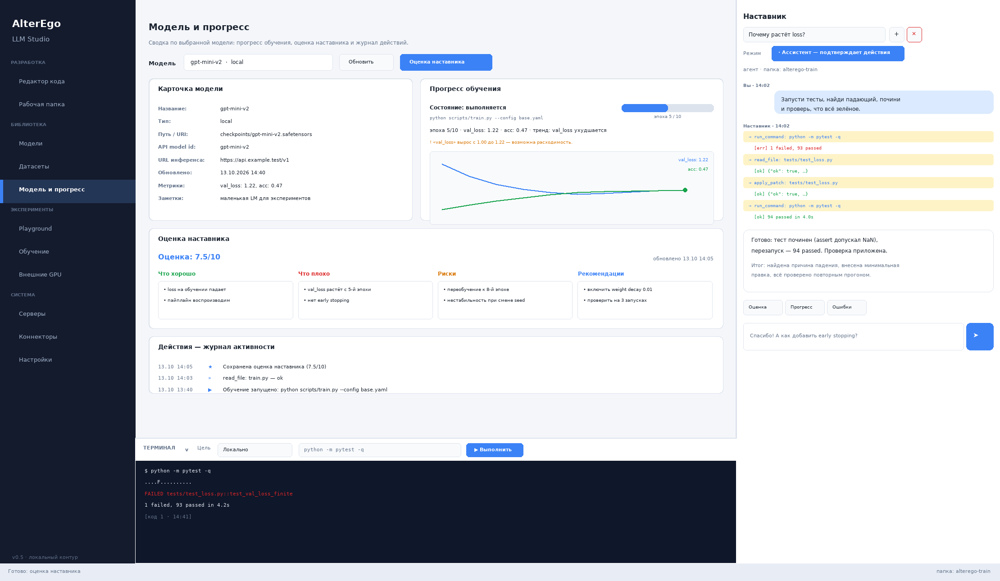
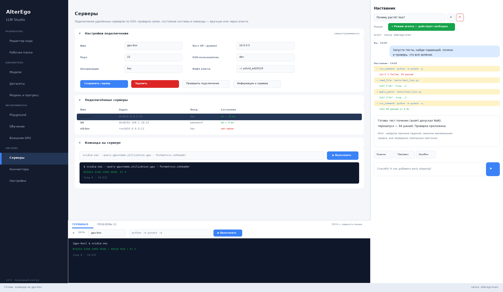

# AlterEgo Training Hub — LLM Studio

A desktop development environment for LLM research with an IDE layout: code editor and terminal in the center, a docked mentor-agent chat on the right, model/dataset library, training with live metrics, model playground, service connectors (GitHub / Hugging Face / Gmail), and RunPod GPU management — all in one Windows-first app.

## Interface

| Editor + terminal + agent chat | Model dashboard | Servers (SSH) |
| --- | --- | --- |
|  |  |  |

Mockups are rendered from the app's real design tokens by `scripts/render_ui_mockup.py`. Settings panels at the top of pages collapse/expand (▼/▶) so the workspace stays clean.

## Keyboard shortcuts

| Shortcut | Action |
| --- | --- |
| `Ctrl+1`…`Ctrl+9` | Pages: editor, workspace, models, datasets, model, playground, training, GPU, servers |
| `Ctrl+0` | Settings |
| `Ctrl+P` | Quick open file (fuzzy) |
| `Ctrl+Shift+P` | Command palette |
| `Ctrl+Shift+F` | Search across the project |
| `Ctrl+K` | Focus the mentor chat |
| `Ctrl+J` | Collapse/expand the bottom panel |
| `Ctrl+Shift+M` | Problems panel |
| `Ctrl+Shift+G` | Source control (Git) panel |
| `Ctrl+W` | Close editor tab |
| `Ctrl+Tab` | Next editor tab |
| `Ctrl+F` / `Ctrl+H` | Find / replace in the editor |
| `F3` / `Shift+F3` | Next / previous match |
| `Ctrl+F2` | Toggle bookmark |
| `F2` / `Shift+F2` | Next / previous bookmark |
| `Ctrl+G` | Go to line |
| `Ctrl+\` | Toggle split editor view |
| `Ctrl+=` / `Ctrl+-` | Zoom the editor font in / out |
| `F5` | Refresh the current page |
| `F1` | Shortcut help |
| `Ctrl+Enter` | Send a chat message |
| `Ctrl+S` | Save file in the editor |

## Editor, palette, search

The editor opens files in **IDE-style tabs** (each tab keeps its buffer, `•` marks unsaved changes, `Ctrl+W` closes, `Ctrl+Tab` cycles) with a cursor position readout and **syntax highlighting** (Python, YAML/JSON, plain text) on a dark code canvas. A **line-number gutter** marks problem lines (● from the Problems tab) and bookmarks (★; click a line number to toggle). **Brackets and quotes auto-close** (typing `)` steps over the pair, Backspace between an empty pair removes both) and the matching bracket is highlighted; **Ctrl+G** jumps to a line. **Ctrl+F** / **Ctrl+H** open find & replace with all matches highlighted, an «1 of N» counter (`F3` / `Shift+F3` cycle matches, `Aa` toggles case sensitivity); **bookmarks** jump with `F2` / `Shift+F2` and toggle with `Ctrl+F2`. The file tree can **create, rename and delete files** (names are validated to stay inside the workspace). A **minimap** on the right edge shows a coloured outline of the file (functions, keywords, comments) and clicking it jumps to that line; **Ctrl+\\** opens a **split editor** with two synchronized panes of the same file. The built-in **Python linter** (`Проверить`, also on save) reports syntax errors and style warnings into the Problems tab and the gutter; the built-in **formatter** (`Формат`, optional on save) normalizes line endings, trailing whitespace, blank-line runs and the final newline, counting every fix. **Ctrl+=** / **Ctrl+-** zoom the editor font. **Autocomplete** suggests words from the file and the Python vocabulary (`Tab`/`Enter` accepts, `Esc` closes, `↑`/`↓` navigates). The UI has **light and dark themes** (Settings → Внешний вид, or the command palette) that switch live and persist. **Ctrl+P** opens any workspace file by fuzzy name; **Ctrl+Shift+P** runs commands from one palette (navigation, training, diagnostics). **Ctrl+Shift+F** searches the workspace by regex and jumps straight to the matching line in the editor.

The bottom panel behaves like VS Code's: **ТЕРМИНАЛ**, **ПРОБЛЕМЫ** and **ГИТ** tabs (`Ctrl+Shift+M`, `Ctrl+Shift+G`, `Ctrl+J` collapses the panel). The Problems tab collects errors from training logs (tracebacks, `FAILED` tests, metric anomalies) and a double-click opens the exact file and line in the editor; the list can be sent to the mentor in one click. The Git tab is a full source-control view: changed files with status and +/− counts, a coloured diff preview, stage/unstage/discard actions, commit with a message, and Push / Pull (fast-forward only). The status bar shows the current **Git branch** with a dirty marker.

## Diagnostics and logs

The **Диагностика** section on the settings page checks the environment (Python, Tk, credential store, paramiko, Git, workspace, disk space, mentor config) and produces a copyable report. Application errors are written to `<app data>/logs/hub.log` (rotated); uncaught crashes show a dialog with the log path.

## Studio features

**Разработка**
- **Редактор кода** — file tree of the workspace, built-in editor (Ctrl+S), "обсудить с наставником" for any file, and **project scaffolding from templates**: a ready-to-run `train.py` + `config.json` + `eval.py` (stdlib-only) whose metrics are parsed by the dashboard out of the box.
- **Рабочая папка** — pick one folder on your PC; all tools and training are confined to it. Git connect/clone/fetch/pull-ff/branch flows included.
- **Терминал** — a bottom panel to run any command in the workspace **or on a connected server** and watch the output, with one-click re-run from history; the panel itself can be collapsed.
- **Наставник-агент** (right panel) — a chat mentor that works as an **autonomous agent**: it can inspect and edit code, run commands, query training state, use connectors and even start/stop training to reach your goal. Two modes: *Ассистент* (every mutating action asks for confirmation) and *Режим агента* (acts freely toward the goal; everything is still backed up and logged).

**Библиотека**
- **Модели** — registry of local checkpoints (`*.safetensors`, `*.gguf`, …) and cloud artefacts (`s3://`, `hf://`, `runpod://`, `https://`), folder scanning, portable JSON manifests. The library folder can be a cloud-synced directory (OneDrive, Yandex.Disk, …).
- **Датасеты** — JSONL/CSV/TXT catalogue with row counts, sizes and previews.
- **Модель и прогресс** — model card, live training chart (loss/acc), trend verdicts, anomaly detection (NaN/Inf, divergence, stagnation), mentor assessment card (score, reasoning, what is good/bad, risks, recommendations) and a full activity trail.

**Эксперименты**
- **Playground** — probe any configured model with test prompts and compare A/B side by side with latency.
- **Обучение** — run training in the workspace, stream logs, auto-send failures to the mentor, persistent run history with metric snapshots and mentor scores. The mentor can query training state itself (status, log tail, run history).
- **Внешние GPU** — live RunPod catalog, GPU-rate budget gate (not a total-bill cap), confirmed pod lifecycle.

**Система**
- **Серверы** — подключение удалённых серверов по SSH: проверка связи, состояние системы (GPU/диск/нагрузка), выполнение команд вручную, из терминала или агентом. Пароли — только в системном хранилище; host-ключи проверяются (TOFU-pinning в `known_hosts`).
- **Коннекторы** — GitHub repository search, Hugging Face model search and model cards, Gmail notifications (SMTP with App Password). Tokens live only in the OS credential store; the same actions are exposed to the mentor-agent as tools.
- **Диагностика** — «Доктор» окружения: Python/Tk, keyring, SSH, Git, папки, диск; копируемый отчёт; лог ошибок `logs/hub.log` с ротацией.
- Settings panels at the top of pages are **collapsible** (hide/show) so the workspace stays clean; **keyboard shortcuts** (F1) for navigation, chat and the terminal.
- API keys only in the OS credential store (`keyring`); settings files contain no secrets.
- Automatic timestamped backups before mentor file edits; JSONL audit trail outside the repository.
- Package as a Windows executable using PyInstaller.

## Features

**Mentor agent with tools**
- Docked chat panel on the right with persistent dialogs (saved per user, no secrets inside).
- The agent can inspect the selected workspace: list/read/search files, edit files, and run commands. Assist mode requires explicit confirmation for every mutating action; **agent mode** performs the whole goal freely (plan → act → verify), while still backing up every edit and logging every call.
- Give the agent a goal ("запусти тесты, найди падающий, почини и проверь") and it loops through tools until the goal is done: it can start/stop training, read metrics and logs, search GitHub and Hugging Face, and send e-mail notifications.
- Works with popular providers through one agent: **OpenAI (GPT/Codex)**, **Anthropic (Claude)**, **Google (Gemini)**, **OpenRouter**, **Ollama** (local models), DeepSeek, Groq, Mistral, or any OpenAI-compatible server; native function calling for Claude and Gemini, with a plain-text ` ```tool ` fallback protocol for models without it.
- Quick commands: model assessment, training progress, log error triage. Structured assessments are saved to the model dashboard automatically.
- The mentor participates in training: send it a training log (or let the app do it automatically on failure) and it will find errors, read the code, and propose fixes. Every edit is backed up before it is applied.

**Remote servers (SSH)**
- Register any SSH-reachable machine (name, host, port, user, key or password auth) on the **Серверы** page; passwords live in the OS credential store, never in files.
- Test the connection, view system info (kernel, GPU, disk, load), and run arbitrary commands — from the page, from the terminal panel (target selector: Локально / server), or through the mentor-agent (`list_servers`, `server_info`, `run_on_server`).
- Host keys are verified against the system known_hosts plus an app-managed pin file (`known_hosts`, trust-on-first-use, `SHA256:…` fingerprint shown); a changed host key is rejected. Remote output is size-capped.
- The transport is paramiko (installed with the app); the registry is a plain JSON file you can edit or sync.

**Training progress and metrics**
- Parses logs for loss/accuracy/lr series, epoch progress, and draws a live chart.
- Trend analysis (улучшается / ухудшается / стабильно) and anomaly detection: NaN/Inf, divergence, stagnation.
- Persistent run history with exit codes, metric snapshots, and mentor scores.

**Model dashboard**
- Model card (kind, location, API id, metrics, notes), training progress with chart, and a full activity feed of actions (training runs, mentor tool calls, file edits, saved reports).
- Mentor assessment card: score 0–10, reasoning, what is good, what is bad, risks, recommendations — rendered as a structured report and exportable to Markdown.

**Models registry**
- Catalogue of models: local checkpoints (`*.safetensors`, `*.gguf`, …) and cloud artefacts (`s3://`, `hf://`, `runpod://`, `https://`).
- The library folder can point at a cloud-synced directory (OneDrive, Google Drive, Yandex.Disk) to keep the catalogue in the cloud.
- Scan folders for checkpoints, export/import a portable JSON manifest.

**Cloud GPUs and security**
- Browse the live RunPod GPU catalog and list GPU pods.
- Preview GPU pricing against a configured GPU-only hourly limit, plus a total budget cap with a spend ledger and pod autostop. Creating, stopping, resuming, or deleting cloud resources requires explicit confirmation. The limit is not a total-bill cap.
- Store API keys in the operating-system credential store through `keyring`; keys are not written into the project settings file or Git repository.
- Package as a Windows executable using PyInstaller.

## Requirements

- Windows 10/11 recommended for the first desktop build.
- Python 3.10 or newer for running from source.
- Git for Windows and a working credential helper for private repositories.
- A RunPod API key only if using RunPod features.
- An API key and model ID for the chosen AI provider (OpenAI, Anthropic, Gemini, OpenRouter, Ollama, …).
- An SSH-reachable server is optional (the `paramiko` package is installed with the app).

## Run from source

From PowerShell in the repository directory:

```powershell
python -m venv .venv
.\.venv\Scripts\Activate.ps1
python -m pip install --upgrade pip
python -m pip install -e ".[dev]"
python run_app.py
```

For private GitHub repositories, authenticate with Git Credential Manager or GitHub CLI before cloning. Do not embed a token in a repository URL.

## Create the Windows application

In PowerShell:

```powershell
.\scripts\build_windows.ps1
```

The build script creates `dist\AlterEgoTrainingHub.exe`. Build and test it on Windows before distributing it. A Windows executable should be built on Windows; the source checkout itself is cross-platform only where Tkinter and an appropriate credential-store backend are available. On Linux/macOS the same PyInstaller pipeline is available as `python scripts/build_desktop.py`. The `Windows Desktop Build` GitHub Actions workflow produces the `.exe` artifact automatically on pushes and pull requests.

## Connect a mentor

In the **Настройки** page pick the AI provider (OpenAI/Codex, Claude, Gemini, OpenRouter, Ollama, DeepSeek, Groq, Mistral or a custom OpenAI-compatible server) — the base URL and model hints fill in automatically. Fetch the model list or type the exact model ID, and save its key. Saving the key uses the operating-system credential store. The connection-test button asks for confirmation before sending (it may consume API credits).

The **ИИ-агент** section configures the agent itself: behaviour profiles (Наставник / Ревьюер / Оптимизатор обучения / Полный), max tool steps, reasoning effort (for OpenAI/Codex), mandatory self-verification of results, subagents for narrow subtasks, and extra system-prompt instructions. The agent sees the full picture of the model and its training (`get_model_info`, `get_metrics_history`, `list_model_catalog`), can correct a **running** training between epochs (`set_training_control`: learning rate, epoch limit, early stopping, gradient clipping, stop), publishes its working plan with per-step statuses (`update_plan` → live checklist in the chat) and spawns read-only subagents (`spawn_subagent`). Every file change is shown as a **unified diff preview** in the confirmation dialog, and `diff_files` lets the agent self-review. In agent mode every change is verified by an independent read-only review pass whose PASSED/FAILED verdict is appended to the report.

While training runs, a **watchdog** monitors the log: loss spikes, a rising loss, plateaus, NaN/Inf and a stalled process raise warnings with concrete suggestions (including hot `set_training_control` fixes), and the «Модель и прогресс» page keeps the metrics chart live.

**Data & evaluation**: download Hugging Face dataset samples in one click, filter and split any dataset into deterministic train/val/test files (also via the agent's `prepare_dataset`), and let the template `train.py` validate every epoch (`val_loss`/`val_acc`/`perplexity`). The evaluation report detects **overfitting** and names the best epoch; the **A/B comparison** overlays two recent runs and names a winner; **hyperparameter suggestions** (`suggest_training_fixes` / «Подобрать параметры») turn watchdog signals into concrete `control.json` changes.

**Model tooling**: export models to **ONNX/GGUF** with artifact verification (GGUF magic, size), **quantize** with Q8_0→Q3_K_M/INT8 recipes (projected size and quality impact, post-checks), **benchmark** models (ms/run, tok/s, ranking table in `benchmarks.json`), and run **batch prompt suites** (5 graded prompts out of the box, custom JSON suites supported). All of it is available from the «Модели» page buttons and as agent tools (`export_model`, `quantize_model`, `benchmark_model`, `run_prompt_suite`).

**Cloud & collaboration**: a **RunPod job queue** for cloud training (submit with cost confirmation, live pod tracking), **full report export** (Markdown or print-ready HTML → PDF) with metrics/eval/watchdog/plan/activity, **session sharing** (Markdown/HTML/JSON export + JSON import), and **access roles** (owner / editor / guest — the guest role turns the agent and every tool strictly read-only).

**Platform**: **plugins** — drop a `*.py` file with a `PLUGIN` dict into the app's `plugins/` folder to give the agent new tools (see `examples/hello_plugin.py`); named **layouts** (code / training / analytics / chat) one click away; **custom hotkeys** for 19 app actions with conflict detection; **RU/EN interface language** switch.

Then use the **Наставник** panel on the right: talk to the mentor, ask it to read your project, find bugs, run tests, or fix code. It can only touch the folder you selected on the **Рабочая папка** page. In *Ассистент* mode every file change or command execution is shown for your confirmation before it happens; in *Режим агента* it acts towards your goal without step-by-step confirmations — review its work via the activity trail and backups (use Git to diff and roll back).

Only use mentor outputs for model development if the selected API/model terms permit that use. Do not send private training data without checking the provider's data handling and terms.

## Connect services (GitHub, Hugging Face, Gmail)

Open the **Коннекторы** page. Tokens and passwords go straight to the OS credential store; nothing is written to settings files. For Gmail use an App Password (Google Account → Security → 2-Step Verification → App passwords) — the app sends through SMTP with STARTTLS. The same connectors are available to the mentor-agent as tools: `search_github`, `search_huggingface`, `huggingface_model_card`, `send_email`.

## Connect cloud GPUs

In the **Внешние GPU** tab, save a RunPod key, refresh the catalog, and select an exact GPU ID. The app reads the provider's current catalog rate before showing a confirmation dialog. The displayed limit covers only the catalog GPU rate, not a guaranteed total bill. Storage, networking, taxes, and other charges can apply. Container-disk data may be lost when a pod is deleted, so copy checkpoints to durable storage.

RunPod REST API v2 is in public beta; this adapter may need maintenance when the provider changes its API.

## Scope and honest limitations

This is a desktop control-plane MVP, not yet an end-to-end training orchestration product. It does not yet copy the selected AI repository to a remote worker, upload datasets, launch training on a cloud GPU, stream remote logs, enforce a total-spend ceiling, or synchronize/resume remote checkpoints. Training runs locally in the chosen workspace folder; cloud resource management is implemented separately. Do not assume that creating a pod starts training. The mentor's file edits are ordinary file writes — in assist mode they are confirmed explicitly, in agent mode they are only backed up and logged, so use Git to review and roll them back.

The next milestone is a typed remote training worker with resumable checkpoint/data transfers, explicit elapsed-time and total-cost guards, live logs, and end-to-end tests on a short disposable job.

## Releases
- 1.4.0: stage 44 — multi-GPU via torchrun/DDP in the wizard and generated script, per-step VRAM in scratch logs, and a total cloud budget cap with a spend ledger and pod autostop.
- 1.3.0: stage 43 — SFT format validation, near-duplicate deduplication and train/eval decontamination on the Datasets page; Ollama/vLLM probe and Ollama start/stop in Playground.
- 1.2.0: stage 42 — Hugging Face Hub download/push from the Models page, and a checkpoints panel on the Training page (discovery, run binding, resume commands, keep-3 rotation).
- 1.1.0: stage 41 — configurable LoRA/QLoRA fine-tuning in the wizard and generated script, per-run reproducibility snapshots (git hash, pip freeze, config), CSV + MLflow export of run history.
- 1.0.0: semantic code search (offline hash embeddings, cached chunk index, optional API embeddings), a real-Tk xvfb smoke job in CI, and the final audit — mypy on 19 modules, 369 tests, coverage 79%.
- 0.36.0: distribution — in-app update check against GitHub Releases (Settings → diagnostics) and a tag-driven release pipeline publishing the Windows .exe, wheel and sdist together.
- 0.35.0: resume after Stop (▶ picks the task up from the transcript) and
  the night watch as a training verifier — it diffs generation samples and
  best val_loss between checks and flags degradation in the morning report.
- 0.34.0: interface polish, round two — palette quick-launch in the sidebar,
  persisted activity-bar mode, clickable status-bar badges incl. tokens
  today, breadcrumbs in page headers, live composer token counter.
- 0.33.0: integrity audit closed — single canonical perplexity, ui.py split
  (ui_night/ui_status), coverage 79% (gate 75) and mypy clean on core
  modules in CI, complete sdist via MANIFEST.in.
- 0.32.0: stop button for the agent — cooperative cancellation checked
  before every step and before executing a requested tool block, with an
  honest “[Stopped by user]” marker in the reply and transcript.
- 0.31.0: live model benchmark — your configured LLM runs three sandboxed
  tasks (fix, create, answer-from-file) with on-disk verification, per-task
  timeouts, token/cost/time report for honest model comparison.
- 0.30.0: parallel read-only agent tool calls (Cursor-style) — independent
  reads/searches in one model block run concurrently with strict result
  ordering, while mutations and confirmations stay strictly sequential.
- 0.29.0: script smoke-run — one-click end-to-end verification of the
  generated train_llm.py (compile, import, CONFIG sanity, real dataset
  load via the script’s own loader, log-format round-trip) without a GPU.
- 0.28.0: wizard now generates a ready-to-run `train_llm.py` (PyTorch loop
  for from-scratch, HF Trainer + PEFT LoRA for fine-tuning) that logs in the
  app’s own metric/sample formats — one click from plan to training.
- 0.27.0: best-in-class agent hardening — loop guard against repeated
  failing calls, transient-error retry with backoff, error classification,
  recovery hints, per-turn stats, and an offline internal agent benchmark
  (5 scripted scenarios on the real tool loop, “Benchmark” button).
- 0.26.0: IDE-grade UX — activity-bar sidebar with badges, primary actions
  top-right in page headers, rich status bar (model/training, clickable),
  chat session search, 📎 file attach by the composer, palette coverage for
  transparency and wizard actions.
- 0.25.0: «Your own LLM» wizard — training paths (LoRA / from scratch /
  recipes), architecture presets, dataset audit (duplicates, PII, quality
  score), GPU/hours/cost calculator before start, a trainable byte-level
  BPE tokenizer, and before/after comparison with verdicts.
- 0.24.0: LLM transparency — thought protocol («Thought → Action → Answer»),
  action trace of every tool call, context/token/cost view, second-pass
  answer critic, and generation samples parsed from training logs.
- 0.23.0: intelligence — overnight agent watch with a morning report,
  metrics dashboards posted into chat, and Colab notebook export from the
  cloud job queue.
- 0.22.0: plugin sandbox (restricted subprocess, timeouts, trust levels)
  and plugin catalog with one-click install/uninstall.
- 0.21.0: UX — drag-and-drop panel docking, resizable bottom panel, settings
  sync between machines (export/import + cloud folder), live language
  switching without restart.
- 0.20.0: full English interface — every page, dialog and help string is
  localized (RU/EN packs, message-as-key safe fallback, extraction tooling
  and coverage tests).
- 0.19.1: stabilization — RunPod plan shape fix, overfitting detection on
  restarted logs, shifted hotkey case variants, live hotkey rebinding,
  accurate package version, full-pipeline integration tests.
- 0.19.0: platform — UI language packs, customizable hotkeys, saved layouts,
  plugin system with tools/mutations and `examples/hello_plugin.py`.
- 0.18.0: engineering — roles/permissions, cloud job queue with RunPod
  integration, report export (MD/HTML/PDF-via-browser), session
  share/import, `alterego_cloud` CLI.

## Tests

```powershell
python -m compileall -q src run_app.py tests
python -m pytest -q
```

GitHub Actions (`CI` workflow) runs lint, compilation and unit tests on Python 3.11/3.12 for every push and pull request, and uploads the wheel/sdist artifacts; the `Windows Desktop Build` workflow packages the `.exe`.
