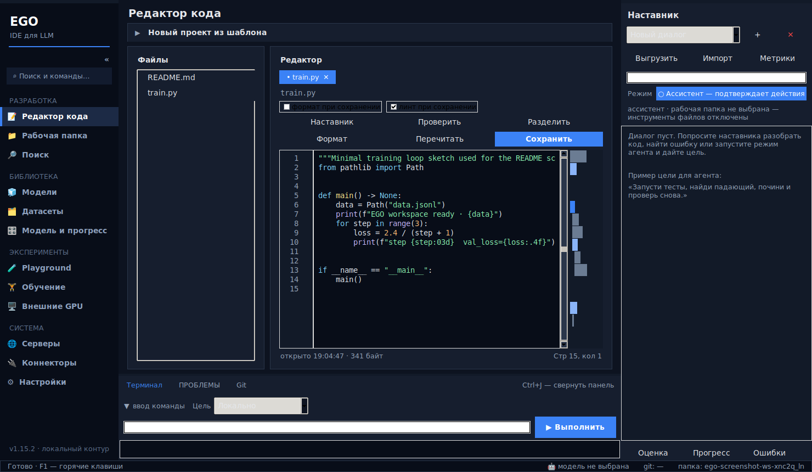

# Зачем нужен EGO

EGO — **IDE для разработки и обучения LLM**: редактор, терминал, данные,
тренировка (SFT / LoRA / с нуля), метрики и наставник в одном окне.

Путь: **свои данные → обучение → метрики → чекпоинт**. Не чат-бот и не
набор разрозненных скриптов Hugging Face.

## Интерфейс

Кадр снимает GitHub Actions с живого окна Tk (тёмная тема, открытый
`train.py`). После изменений UI он обновляется в этой папке.

## Что делает

1. **Данные** — датасеты, аудит, шаблоны чата, сплит train/val.
2. **Обучение** — SFT / LoRA, живой лог и график loss, watchdog.
3. **Оценка** — val_loss, сэмплы, сравнение запусков.
4. **Код** — редактор, терминал, git, наставник у лога.
5. **Железо** — локальный запуск или внешние GPU.

## Где в интерфейсе

| Задача | Страница |
|---|---|
| Код и скрипт обучения | Редактор |
| Данные | Датасеты |
| Запуск | Обучение |
| Loss | Модель и прогресс |
| Облачная карта | Внешние GPU |

Замеры стека — [BENCHMARK.md](BENCHMARK.md).
